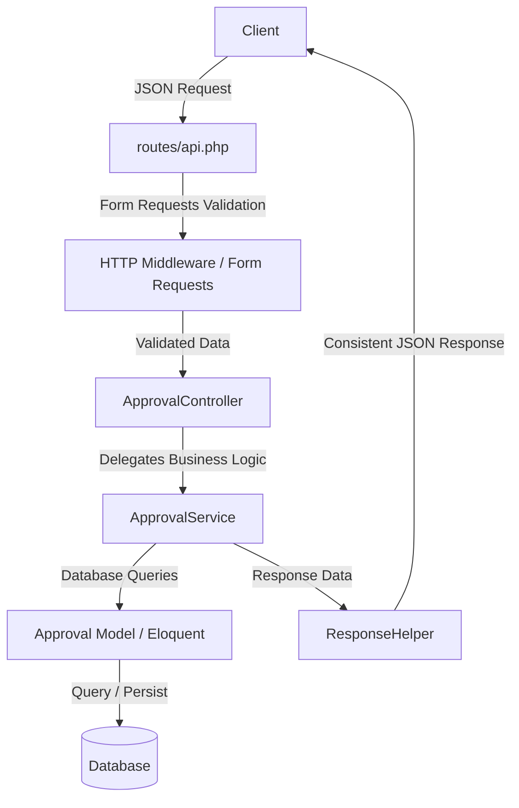
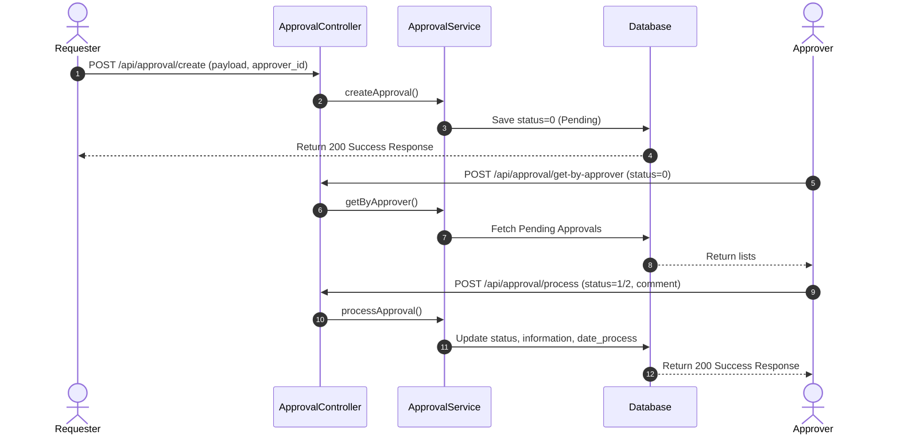

# Approval Module Backend API

## Description
This project is an enterprise-grade **Approval Module Backend API** built using Laravel 11. It provides a structured, decoupled service-oriented architecture designed to handle multi-party approval workflows. The system tracks requests initiated by users (`requester` role) and processes decisions (approve/reject/pending statuses) made by designated decision-makers (`approver` role).

Key capabilities include:
- Creating approval requests with dynamic custom payload data.
- Tracking process statuses, execution times, and logs.
- Filtering and paginating requests for both requesters and approvers.
- Standardized API response format for seamless frontend integration.

---

## System Summary

| Item           | Description |
| -------------- | ----------- |
| Framework      | Laravel 11.9 |
| PHP Version    | ^8.2 |
| Database       | SQLite (Default configured in `.env.example`), expandable to MySQL/PostgreSQL |
| Authentication | Laravel Sanctum (Migration and route configuration present, but actual auth guards on approval endpoints are not enforced in the current routing configuration) |
| Queue          | Database Driver (Supported via `jobs` schema configuration) |
| Cache          | Database Driver (Supported via `cache` schema configuration) |
| Storage        | Local File Storage |

---

## Key Features

- **Approval Request Creation**: Allows requesters to initiate approval workflows with specific payloads, metadata (`module`, `sub_modul`, `action`), and assign them to specific approvers.
- **Workflow Processing**: Facilitates status updates (e.g., approve/reject) by authorized approvers along with auditing comments/information.
- **Requester-Specific Tracking**: Enables requesters to list, filter, search, and paginate through their submitted requests.
- **Approver-Specific Tracking**: Enables approvers to retrieve, filter, search, and paginate through requests awaiting their action.
- **Detailed History**: Retrieves full history, processed dates, actions, and historical request payload data for individual approval transactions.
- **Standardized Response Helper**: Centralized success and error response utility to maintain API signature consistency.

---

## Backend Architecture

This project adopts a **Controller-Service-Model** pattern to separate HTTP layers, validation constraints, business logic, and database operations.



---

## Directory Structure

```text
app/
├── Helpers/
│   └── ResponseHelper.php          # Centralized success and error response formatting utility
├── Http/
│   ├── Controllers/
│   │   ├── ApprovalController.php  # Handles HTTP requests, calls Services, and returns responses
│   │   └── Controller.php          # Base Controller class
│   └── Requests/
│       ├── ApproverRequest.php     # Validation rules for listing approver items
│       ├── CreateRequest.php       # Validation rules for creating a new approval request
│       ├── CreateUserRequest.php   # User validation template (Default authorized to false)
│       ├── DetailRequest.php       # Validation rules for retrieving single approval details
│       ├── ProcessRequest.php      # Validation for updating/processing an approval status
│       └── RequesterRequest.php    # Validation rules for listing requester items
├── Models/
│   ├── Approval.php                # Eloquent model representing the 'approval' table
│   └── User.php                    # Eloquent model representing the 'users' table
├── Providers/
│   └── AppServiceProvider.php      # Service binding and application bootstrapping configuration
└── Services/
    ├── ApprovalService.php         # Contains core business logic for processing and querying approvals
    └── UserServices.php            # Service placeholder for user-related business operations
```

### Directory Explanations
- **`app/Helpers/`**: Contains custom global helper classes. `ResponseHelper` standardizes success and error structures for the frontend.
- **`app/Http/Controllers/`**: Thin controller layer responsible only for handling routing inputs, validating HTTP payloads, invoking services, and returning formatted responses.
- **`app/Http/Requests/`**: Houses Laravel Form Requests. These encapsulate validation rules and error-handling logic before controllers receive data.
- **`app/Services/`**: Business logic layer. Separates the core application workflow from controllers to facilitate unit testing and reusability.
- **`app/Models/`**: Eloquent models mapping database tables to PHP objects, handling json casting, and fillable fields.

---

## Installation

### Clone Repository

```bash
git clone <repository_url>
cd approval-module
```

### Install Dependencies

```bash
composer install
```

### Environment File Setup

```bash
cp .env.example .env
```

### Generate Application Key

```bash
php artisan key:generate
```

### Run Migrations

```bash
php artisan migrate
```

### Database Seeding

```bash
php artisan db:seed
```

### Start Development Server

```bash
php artisan serve
```

---

## Environment Configuration

Below are the key configuration variables found in `.env.example`:

| Variable | Description | Default Value |
| --- | --- | --- |
| `APP_NAME` | Name of the application | `Laravel` |
| `APP_ENV` | Environment stage | `local` |
| `APP_KEY` | Application encryption key | `[Generated on setup]` |
| `APP_DEBUG` | Detailed error reporting switch | `true` |
| `APP_TIMEZONE` | System default timezone | `UTC` |
| `APP_URL` | Application root URL | `http://localhost` |
| `LOG_CHANNEL` | Logging stack channel | `stack` |
| `LOG_LEVEL` | Default log level threshold | `debug` |
| `DB_CONNECTION` | Database driver to use | `sqlite` |
| `QUEUE_CONNECTION` | Queue processing backend driver | `database` |
| `CACHE_STORE` | Cache driver store | `database` |
| `SESSION_DRIVER` | Session store driver | `database` |

---

## Database Schema

The active migrations define the following tables:

### 1. `users` Table
Stores authentication details for users acting as requesters or approvers.

| Column | Type | Constraints | Description |
| --- | --- | --- | --- |
| `id` | bigint | Primary Key, Auto Increment | Unique user identifier |
| `name` | string | - | Full name of the user |
| `email` | string | Unique | Email address used for login |
| `email_verified_at` | timestamp | Nullable | Verification timestamp |
| `password` | string | - | Hashed password |
| `remember_token` | string | Nullable | Remember token for sessions |
| `created_at` | timestamp | Nullable | Record creation timestamp |
| `updated_at` | timestamp | Nullable | Record modification timestamp |

### 2. `approval` Table
*(Note: Migration file is not found in the source code. The schema is mapped below from the `Approval` model attribute properties and controller behavior.)*

| Column | Type | Constraints | Description |
| --- | --- | --- | --- |
| `id` | bigint | Primary Key, Auto Increment | Unique approval transaction identifier |
| `data_id` | integer | Not Null | Foreign reference identifier of the module data being approved |
| `user_id_start` | integer | Not Null | User ID who initiated/requested the approval |
| `user_id_approver` | integer | Not Null | User ID assigned to approve or reject the request |
| `module` | string | Not Null | Main module descriptor (e.g., `Finance`) |
| `sub_modul` | string | Not Null | Sub-module descriptor (e.g., `Reimbursement`) |
| `action` | string | Not Null | Action type triggered (e.g., `CREATE`, `UPDATE`) |
| `information` | string | Not Null | Contextual details or notes |
| `data` | text / json | Not Null | Raw payload data being approved (stored as casted array) |
| `status` | integer | Not Null (Default `0`) | Approval status state (`0 = Pending`, `1 = Approved`, `2 = Rejected`, etc.) |
| `date_process` | datetime | Nullable | Timestamp when processed by the approver |
| `created_at` | timestamp | Nullable | Creation timestamp |
| `updated_at` | timestamp | Nullable | Last update timestamp |
| `deleted_at` | timestamp | Nullable | Soft delete timestamp placeholder |

### Relationships
- **User / Approval relationship**: Model relationship functions (`belongsTo`, `hasMany`) are *not explicitly declared* in the source code. However, `user_id_start` and `user_id_approver` conceptually map to the `users.id` primary keys.

---

## Model Specifications

### Model: `User`
- **Table Name**: `users`
- **Fillable Fields**: `name`, `email`, `password`
- **Hidden Fields**: `password`, `remember_token`
- **Casts**:
  - `email_verified_at` => `datetime`
  - `password` => `hashed`

### Model: `Approval`
- **Table Name**: `approval`
- **Fillable Fields**: `data_id`, `user_id_start`, `user_id_approver`, `module`, `sub_modul`, `action`, `information`, `data`, `status`, `date_process`, `created_at`, `updated_at`, `deleted_at`
- **Casts**:
  - `data` => `array`

---

## API Documentation

All endpoints receive and return JSON payloads.

### Module: Authentication (Default Laravel Sanctum)
*Not enforced in the main Approval API endpoints, but configured in the environment.*

---

### Module: Approval Management

#### 1. Create Approval Request
Creates a new approval process.

- **Endpoint**: `POST /api/approval/create`
- **Middleware**: None (Publicly exposed API)
- **Request Body**:
```json
{
  "data_id": 101,
  "user_id_start": 1,
  "user_id_approver": 2,
  "module": "Inventory",
  "sub_modul": "StockIn",
  "action": "CREATE",
  "information": "Requesting stock replenishment approval for Warehouse A",
  "data": {
    "items": [
      { "item_id": 5, "quantity": 100 }
    ]
  }
}
```
- **Success Response (200 OK)**:
```json
{
  "responseCode": 200,
  "responseMessage": "Successfully create data",
  "responseData": {
    "data_id": 101,
    "user_id_start": 1,
    "user_id_approver": 2,
    "module": "Inventory",
    "sub_modul": "StockIn",
    "action": "CREATE",
    "data": {
      "items": [
        { "item_id": 5, "quantity": 100 }
      ]
    },
    "status": 0,
    "information": "Requesting stock replenishment approval for Warehouse A"
  }
}
```

---

#### 2. Process Approval Decision
Updates the status and logs notes for an active approval.

- **Endpoint**: `POST /api/approval/process`
- **Middleware**: None
- **Request Body**:
```json
{
  "id": 1,
  "status": 1,
  "information": "Approved. Quantities match request logs."
}
```
- **Success Response (200 OK)**:
```json
{
  "responseCode": 200,
  "responseMessage": "Successfully update data",
  "responseData": {
    "id": 1,
    "status": 1,
    "information": "Approved. Quantities match request logs."
  }
}
```

---

#### 3. Get Approval Details
Retrieves detailed information for a single approval transaction.

- **Endpoint**: `POST /api/approval/detail`
- **Middleware**: None
- **Request Body**:
```json
{
  "id": 1
}
```
- **Success Response (200 OK)**:
```json
{
  "responseCode": 200,
  "responseMessage": "Successfully get data",
  "responseData": [
    {
      "id": 1,
      "data_id": 101,
      "user_id_start": 1,
      "user_id_approver": 2,
      "module": "Inventory",
      "sub_modul": "StockIn",
      "action": "CREATE",
      "data": {
        "items": [
          { "item_id": 5, "quantity": 100 }
        ]
      },
      "status": 1,
      "information": "Approved. Quantities match request logs.",
      "date_process": "Jun 10, 2026",
      "created_date": "Jun 10, 2026"
    }
  ]
}
```

---

#### 4. Get Approver Requests (List)
Retrieves approval workflows assigned to the current approver context. Supporting optional status filter, text searches, and pagination.

- **Endpoint**: `POST /api/approval/get-by-approver`
- **Middleware**: None
- **Request Body**:
```json
{
  "status": 0,
  "keyword": "Inventory",
  "limit": 10
}
```
- **Success Response (200 OK)**:
```json
{
  "responseCode": 200,
  "responseMessage": "Successfully get data",
  "responseData": [
    {
      "id": 1,
      "data_id": 101,
      "user_id_start": 1,
      "user_id_approver": 2,
      "module": "Inventory",
      "sub_modul": "StockIn",
      "action": "CREATE",
      "data": {
        "items": [
          { "item_id": 5, "quantity": 100 }
        ]
      },
      "status": 0,
      "information": "Requesting stock replenishment approval for Warehouse A",
      "date_process": "Jun 10, 2026",
      "created_date": "Jun 10, 2026"
    }
  ]
}
```

---

#### 5. Get Requester Requests (List)
Retrieves approval workflows initiated by a specific requester.

- **Endpoint**: `POST /api/approval/get-by-requester`
- **Middleware**: None
- **Request Body**:
```json
{
  "user_id_start": 1,
  "status": 0,
  "keyword": "Inventory",
  "limit": 10
}
```
- **Success Response (200 OK)**:
```json
{
  "responseCode": 200,
  "responseMessage": "Successfully get data",
  "responseData": [
    {
      "id": 1,
      "data_id": 101,
      "user_id_start": 1,
      "user_id_approver": 2,
      "module": "Inventory",
      "sub_modul": "StockIn",
      "action": "CREATE",
      "data": {
        "items": [
          { "item_id": 5, "quantity": 100 }
        ]
      },
      "status": 0,
      "information": "Requesting stock replenishment approval for Warehouse A",
      "date_process": "Jun 10, 2026",
      "created_date": "Jun 10, 2026"
    }
  ]
}
```

---

## Authentication & Authorization

Authentication is configured via Laravel Sanctum middleware in `routes/api.php` only for the `/api/user` endpoint:
- **Sanctum Configuration**: Defined in `config/sanctum.php`.
- **Token Model**: Migration table `personal_access_tokens` handles token lifecycle.
- **Enforcement Status**: The Approval endpoints (`/api/approval/*`) are currently open and lack active middleware guards. Users are identified via the request body input parameters `user_id_start` or `user_id_approver` instead of authenticated session credentials.
- **Permission System**: No role/permission engine (e.g., Spatie Laravel-Permission) is integrated. Authorization is implicitly expected to be validated by comparing parameters against application users.

---

## Business Process

The logical flow of the system is structured as follows:



---

## Queue & Background Jobs

- **Queue Driver**: Configured in `.env` as `database`.
- **Job List**: Built-in tables `jobs`, `job_batches`, and `failed_jobs` migrations are present.
- **Custom Jobs**: No custom Jobs or Queued Listeners are implemented in the `app/Jobs` directory.

---

## Events & Listeners

| Event | Listener | Function |
| --- | --- | --- |
| Tidak ditemukan pada source code. | Tidak ditemukan pada source code. | Tidak ditemukan pada source code. |

---

## External Integrations

| Service | Function |
| --- | --- |
| Payment Gateway | Tidak ditemukan pada source code. |
| Email Service | Tidak ditemukan pada source code. |
| SMS Gateway | Tidak ditemukan pada source code. |
| Webhook | Tidak ditemukan pada source code. |

---

## Logging & Exception Handling

- **Log Channel**: Configured via `config/logging.php`. Uses standard Laravel `stack` driver logging.
- **Global Exceptions Handler**:
  - Defined in [Handler.php](file:///c:/Project/Portfolio/approval-module/app/Exceptions/Handler.php).
  - Intercepts framework exceptions and formats them using `ResponseHelper::errorResponse`:
    - `AuthenticationException` => Returns `401 Unauthenticated` JSON.
    - `MethodNotAllowedHttpException` => Returns `405 Invalid Method` JSON.
    - `NotFoundHttpException` => Returns `404 URL Not Found` JSON.
    - `ValidationException` => Returns `422 Validation Error` JSON.
    - Standard `Throwable` exception catchall => Returns `500 Something went wrong` JSON containing message, file, and line trace.

---

## Deployment Guide

### Linux Server Configuration
1. Set up a standard PHP 8.2+ running environment (LEMP or LAMP stack).
2. Configure your virtual host root directory to point to the `public/` directory.

### Nginx Configuration
```nginx
server {
    listen 80;
    server_name your-domain.com;
    root /var/www/approval-module/public;

    add_header X-Frame-Options "SAMEORIGIN";
    add_header X-Content-Type-Options "nosniff";

    index index.php;

    charset utf-8;

    location / {
        try_files $uri $uri/ /index.php?$query_string;
    }

    location = /favicon.ico { access_log off; log_not_found off; }
    location = /robots.txt  { access_log off; log_not_found off; }

    error_page 404 /index.php;

    location ~ \.php$ {
        fastcgi_pass unix:/var/run/php/php8.2-fpm.sock;
        fastcgi_param SCRIPT_FILENAME $realpath_root$fastcgi_script_name;
        include fastcgi_params;
    }

    location ~ /\.(?!well-known).* {
        deny all;
    }
}
```

### Docker / Docker Compose
Tidak ditemukan pada source code.

### Supervisor & Queue Workers
If queuing tasks are implemented in future updates, run the supervisor process pointing to the artisan worker.
```ini
[program:laravel-worker]
process_name=%(program_name)s_%(process_num)02d
command=php /var/www/approval-module/artisan queue:work database --sleep=3 --tries=3 --max-time=3600
autostart=true
autorestart=true
stopasgroup=true
killasgroup=true
user=www-data
numprocs=2
redirect_stderr=true
stdout_logfile=/var/www/approval-module/storage/logs/worker.log
stopwaitsecs=3600
```

### Task Scheduling
Configure cron on your server to execute the Laravel scheduler hourly/minutely:
```bash
* * * * * cd /var/www/approval-module && php artisan schedule:run >> /dev/null 2>&1
```

---

## Troubleshooting

- **Validation Errors (400 Bad Request)**: Ensure that headers include `Accept: application/json` and all mandatory parameters (e.g., `data_id`, `user_id_start`, `user_id_approver` are valid integers) are present.
- **SQLite Database Locked / Database Empty Exception**: If you experience missing table errors on startup, run `php artisan migrate` first to initialize SQLite databases.
- **Non-functional Exception Handler**: If exception errors return HTML stack traces instead of JSON structures, ensure the custom handler class in `app/Exceptions/Handler.php` is properly integrated or registered inside `bootstrap/app.php` using the modern Laravel 11 config wrapper.

---

## Development Recommendations

1. **Authentication Enforcement**: Secure the Approval endpoints (`/api/approval/*`) under the `auth:sanctum` middleware block rather than allowing unauthenticated public requests to pass arbitrary `user_id_approver` inputs.
2. **Implement Missing Migration**: Create the migration file for the `approval` database table to make sure standard installs run smoothly with `php artisan migrate` out of the box.
3. **Database Relationships**: Explicitly define relationship functions in `Approval.php` (e.g. `belongsTo(User::class, 'user_id_start')`) to make eager loading possible and improve database optimization.
4. **Soft Delete Trait**: Integrate `Illuminate\Database\Eloquent\SoftDeletes` into `Approval.php` since `deleted_at` exists in the fillable columns but does not have the soft delete behavior active.

---

## Conclusion
The **Approval Module Backend API** is built using a clean service-oriented implementation pattern. It separates validation, controller handlers, and business services cleanly. Enforcing authentication, adding the missing migration, and linking Eloquent relationships will elevate this codebase to an enterprise-production readiness level.
